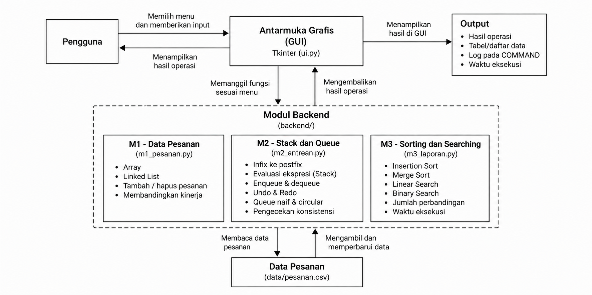
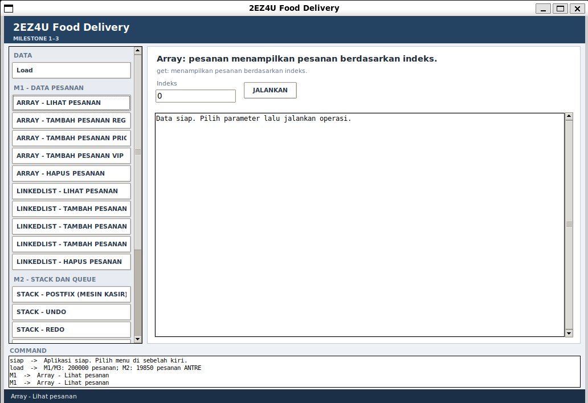
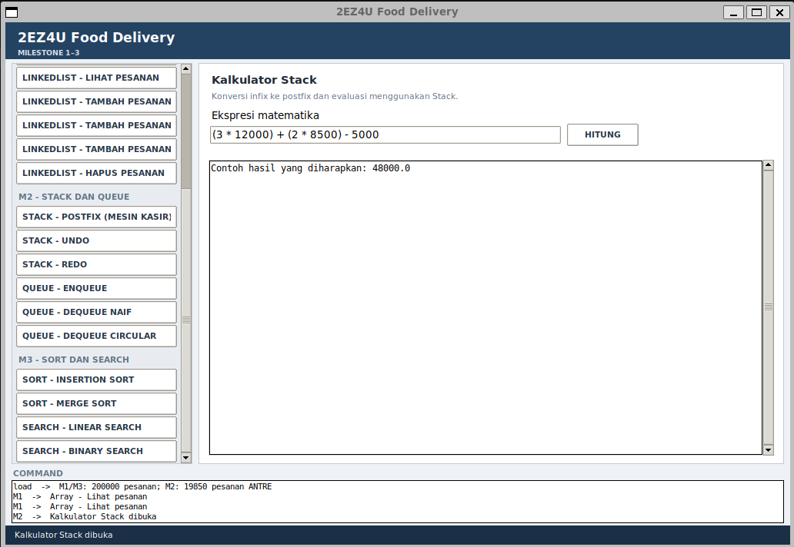
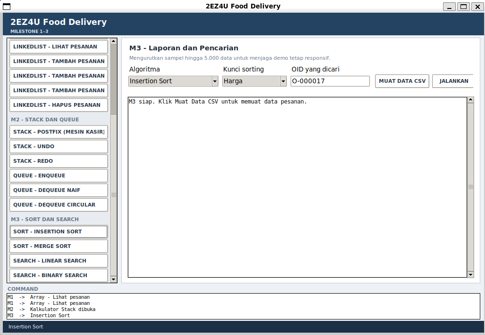

# 2EZ4U Food Delivery

## 1. Deskripsi Proyek

2EZ4U Food Delivery merupakan aplikasi pengelolaan data pesanan makanan yang dikembangkan dengan Python. Aplikasi ini menerapkan beberapa konsep struktur data dan algoritma untuk mengelola pesanan, memproses antrean, serta melakukan pengurutan dan pencarian data.

Proyek ini mencakup tiga milestone:

- **M1 — Data Pesanan:** Implementasi struktur data Array dan Linked List untuk melihat, menambah, dan menghapus pesanan.
- **M2 — Stack dan Queue:** Implementasi Stack untuk evaluasi ekspresi matematika serta Queue untuk pengelolaan antrean pesanan. Fitur yang tersedia juga mencakup Undo/Redo dan perbandingan kinerja antrean.
- **M3 — Sorting dan Searching:** Implementasi Insertion Sort, Merge Sort, Linear Search, dan Binary Search untuk mengolah dan mencari data pesanan.

Aplikasi dilengkapi antarmuka grafis (GUI) berbasis Tkinter agar pengguna dapat menjalankan operasi melalui menu dan melihat hasil serta waktu eksekusinya.

## 2. Tools yang Digunakan

- **Bahasa pemrograman:** Python
- **GUI:** Tkinter
- **Penyimpanan data:** CSV
- **Editor:** Visual Studio Code
- **Platform:** WSL Ubuntu

## 3. Struktur Folder

```text
2ez4u/
├── app.py
├── README.md
├── backend/
│   ├── m1_pesanan.py
│   ├── m2_antrean.py
│   └── m3_laporan.py
├── data/
│   └── pesanan.csv
└── frontend/
    └── ui.py
```

Keterangan:

- `app.py`: Titik masuk untuk menjalankan aplikasi
- `backend/m1_pesanan.py`: Implementasi struktur data dan operasi pesanan pada M1
- `backend/m2_antrean.py`: Implementasi Stack, Queue, Undo/Redo, dan operasi terkait pada M2
- `backend/m3_laporan.py`: Implementasi algoritma pengurutan dan pencarian pada M3
- `data/pesanan.csv`: Data pesanan yang digunakan aplikasi
- `frontend/ui.py`: Implementasi antarmuka grafis aplikasi
- `README.md`: Detail proyek

## 4. Cara Menjalankan Aplikasi

### Persyaratan

- Python 3
- Tkinter
- Visual Studio Code
- WSL Ubuntu 

Tkinter umumnya tersedia bersama instalasi Python. Jika modul Tkinter belum tersedia pada Ubuntu, instalasikan paket yang sesuai sebelum menjalankan aplikasi.

### Langkah Menjalankan

1. Buka folder proyek `2ez4u` di Visual Studio Code.
2. Pastikan folder `data` berisi file `pesanan.csv`.
3. Buka terminal pada VS Code.
4. Jalankan perintah berikut:

```bash
cd /mnt/d/2ez4u
python3 app.py
```

Jika folder proyek berada di lokasi lain, sesuaikan perintah `cd` dengan lokasi folder tersebut.

5. Setelah jendela aplikasi muncul, pilih fitur yang ingin digunakan melalui menu navigasi.

## 5. Diagram



## 6. Implementasi dan Fitur

### 6.1 M1 — Data Pesanan

M1 berfokus pada pengelolaan data pesanan menggunakan dua struktur data, yaitu Array dan Linked List.

Fitur yang tersedia:

- Melihat pesanan berdasarkan indeks.
- Menambahkan pesanan reguler.
- Menambahkan pesanan prioritas.
- Menambahkan pesanan VIP.
- Menghapus pesanan berdasarkan indeks.
- Memeriksa konsistensi data antara Array dan Linked List.
- Menampilkan waktu eksekusi operasi untuk membandingkan kinerja struktur data.



### 6.2 M2 — Stack dan Queue

M2 menerapkan struktur data Stack dan Queue untuk mendukung pemrosesan ekspresi matematika dan pengelolaan antrean pesanan.

Fitur yang tersedia:

- Mengonversi ekspresi matematika dari infix ke postfix.
- Mengevaluasi ekspresi menggunakan Stack.
- Menambahkan item ke antrean menggunakan enqueue.
- Mengambil item dari antrean menggunakan dequeue.
- Membandingkan implementasi Queue naif dan Circular Queue.
- Melakukan Undo dan Redo pada operasi antrean.
- Memeriksa konsistensi antrean.



### 6.3 M3 — Sorting dan Searching

M3 berfokus pada pengurutan dan pencarian data pesanan.

Algoritma yang diimplementasikan:

- **Insertion Sort:** Mengurutkan data menggunakan metode penyisipan.
- **Merge Sort:** Mengurutkan data menggunakan pendekatan divide and conquer.
- **Linear Search:** Mencari data dengan memeriksa elemen secara berurutan.
- **Binary Search:** Mencari data pada data yang telah diurutkan berdasarkan kunci pencarian.

Informasi yang ditampilkan mencakup jumlah data yang diproses, jumlah perbandingan, waktu eksekusi, dan hasil pengurutan atau pencarian sesuai operasi yang dipilih.

Untuk menjaga waktu respons aplikasi, penggunaan Insertion Sort pada GUI dibatasi pada sampel data. Batas yang digunakan pada antarmuka perlu disesuaikan dengan implementasi aktual.


